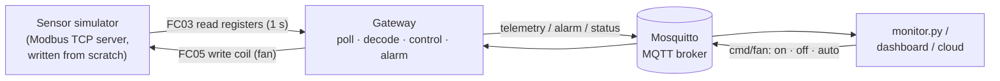

# Modbus TCP → MQTT IoT Gateway

A small industrial IoT system: a simulated factory sensor speaks **Modbus TCP**, and a
**gateway** polls it, publishes the data to an **MQTT** broker, raises alarms, and
controls a cooling fan in a closed loop. Remote users can override the fan through MQTT.

It mirrors what real industrial IoT gateways do: connect field devices (Modbus) to IT and
cloud systems (MQTT).



## What it does

| Feature | How |
|---|---|
| Modbus TCP device | Hand-written server: MBAP header parsing, function codes 01/03/05/06, exception responses (`0x83 02` etc.), big-endian encoding |
| Sensor physics | Temperature rises toward 36 °C with the fan off and falls toward 22 °C with the fan on, with noise; humidity and pressure drift slowly |
| Polling + decoding | Gateway reads 5 holding registers every second and converts scaled integers to real values (`234` → `23.4 °C`, signed int16 via two's complement) |
| Closed-loop control | Fan **auto** mode with hysteresis: ON at ≥ 30 °C, OFF at ≤ 27 °C, so the relay doesn't chatter around one value |
| Remote command | Publish `on` / `off` / `auto` to `…/cmd/fan`; the gateway writes the Modbus coil |
| Alarm | HIGH_TEMPERATURE raised at ≥ 33 °C, cleared at ≤ 31 °C, published only when the state changes (retained) |
| Fault tolerance | Lost Modbus device → error telemetry + reconnect with exponential backoff (1, 2, 4, 8… s, max 30 s) |
| Liveness | MQTT **Last Will**: if the gateway crashes, the broker publishes `offline` automatically |
| Deployment | Docker image (non-root), Docker Compose with Mosquitto |
| Tests | 12 pytest tests, including raw protocol bytes and a real `pymodbus` client talking to the hand-written server |

## Register map

| Address | Type | Meaning | Encoding |
|---|---|---|---|
| HR 0 | holding register | temperature | °C × 10, signed int16 |
| HR 1 | holding register | humidity | %RH × 10 |
| HR 2 | holding register | pressure | hPa × 10 |
| HR 3 | holding register | status | bit0 running, bit1 fan on |
| HR 4 | holding register | heartbeat | +1 per update, wraps at 65535 |
| Coil 0 | coil | fan | write `0xFF00` = ON, `0x0000` = OFF |

## MQTT topics

Base: `demo/line1/sensor01`

| Topic | Direction | Payload |
|---|---|---|
| `…/telemetry` | gateway → | `{"temperature_c": 28.1, "humidity_pct": 50.1, "pressure_hpa": 1013.5, "fan_on": false, "fan_mode": "auto", "heartbeat": 51, "ts": …}` |
| `…/alarm` | gateway → (retained) | `{"type": "HIGH_TEMPERATURE", "active": true, "temperature_c": 33.0, …}` |
| `…/status` | gateway → (retained, Last Will) | `online` / `offline` |
| `…/fan/mode` | gateway → (retained) | `auto` / `on` / `off` |
| `…/cmd/fan` | → gateway | `on` / `off` / `auto` |

## Run it

With Docker:

```bash
docker compose up -d --build
```

Watch the data (needs Python with `paho-mqtt` installed):

```bash
python monitor.py
```

Force the fan off and watch the temperature climb until the alarm fires, then return to auto:

```bash
python monitor.py fan off
```

```bash
python monitor.py fan auto
```

Simulate a broken sensor and watch the gateway recover:

```bash
docker compose stop sensor
```

Run the tests:

```bash
python -m pytest -q
```

Without Docker, run the three parts in separate terminals (you still need an MQTT broker, e.g. Mosquitto, on port 1883):
`python -m sensor_sim.modbus_server`, `python -m gateway.gateway`, `python monitor.py`.

## Sample output

```
>>> sent fan command: off
[telemetry] temp= 30.8C  hum=49.7%  press=1013.6hPa  fan=OFF (off)  hb=61
[telemetry] temp= 33.0C  hum=47.8%  press=1013.7hPa  fan=OFF (off)  hb=73
[ALARM] HIGH_TEMPERATURE RAISED at 33.0C
[fan/mode] auto
[ALARM] HIGH_TEMPERATURE cleared at 30.5C
[telemetry] ERROR: cannot reach Modbus device        ← sensor stopped
gateway WARNING Modbus problem … (retry in 1s / 2s / 4s / 8s)
gateway INFO Modbus connected to sensor:5020          ← recovered by itself
```

## Design notes

- **Why write the Modbus server by hand?** To understand the protocol at the byte level:
  `00 01 | 00 00 | 00 06 | 01 | 03 00 00 00 05` = transaction 1, protocol 0, 6 bytes follow,
  unit 1, read 5 holding registers from address 0. The test suite checks that the standard
  `pymodbus` client accepts these frames, including error responses.
- **Why hysteresis?** With one threshold, noise around 30 °C would switch the fan on and off
  many times per minute and wear out a real relay or contactor.
- **Why MQTT on top of Modbus?** Modbus is request/response polling on a local network.
  MQTT is publish/subscribe, so many consumers (dashboards, databases, the cloud) can receive
  data without each one polling the device.
- **Port 5020 instead of 502**: ports under 1024 need admin rights; real devices use 502.
- **Production next steps**: MQTT authentication and TLS (port 8883), Modbus RTU over RS-485
  for serial devices, buffering data locally while the broker is down, and Grafana/InfluxDB
  for history.

## Project layout

```
common/registers.py        register map + encode/decode (two's complement, scaling)
sensor_sim/modbus_server.py Modbus TCP server + sensor physics
gateway/logic.py           hysteresis + fan controller (pure logic, unit tested)
gateway/gateway.py         polling loop, MQTT, commands, alarms, reconnect
monitor.py                 CLI subscriber / command sender
tests/                     pytest suite
```
